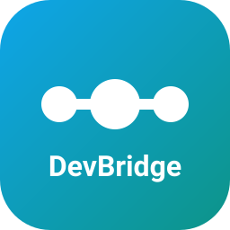

# DevBridge

<p align="center">
  
</p>

<p align="center">
  <strong>开发隧道服务 · 建隧道 / 绑端口 / Host 托管 / Connect 连接 —— 本地服务无需公网入站端口即可远程可达</strong>
</p>

<p align="center">
  <a href="README.zh-CN.md">中文</a> · <a href="README.md">English</a> · <a href="https://huaweicloud.github.io/devspace-devbridge/">在线文档</a> · <a href="https://huaweicloud.github.io/devspace-devbridge/guide/quickstart">快速开始</a> · <a href="#架构">架构</a> · <a href="cli/README.md">CLI</a> · <a href="go-sdk/README.md">Go SDK</a>
</p>

<p align="center">
  <a href="LICENSE"></a>
  
  
  <a href="https://huaweicloud.github.io/devspace-devbridge/"></a>
</p>

DevBridge 是华为云的开发隧道服务。它在 **Host**（运行本地服务的设备）与 **Connect**（需要访问该服务的设备）之间通过 **Gateway** 中继，使本地服务无需开放任何公网入站端口即可被远程访问。Host 与 Connect 都向中继发起出站 WebSocket 连接——无需入站端口，也无需在服务主机上暴露防火墙规则。

📖 在线文档：<https://huaweicloud.github.io/devspace-devbridge/>

---

## 简介

DevBridge 是开发隧道服务，通过云侧 **Gateway** 中继本地服务，使其无需开放入站端口即可被远程访问。它有两种模式——**Host** 将本地服务端口暴露到中继，**Connect** 开启本地监听器转发到远端隧道——两者均向 Gateway 发起出站连接。可通过 [CLI](cli/README.md) 或 [Go SDK](go-sdk/README.md) 使用。

## 架构

```text
┌─────────────┐    WebSocket + TLS 1.3    ┌──────────────┐    WebSocket + TLS 1.3    ┌─────────────┐
│  Host       │ ◄──────────────────────► │   Gateway    │ ◄──────────────────────► │ Connect     │
│  (Listen)   │    SSH data channel       │  (Relay)     │    SSH data channel       │  (Send)     │
└──────┬──────┘                          └──────────────┘                          └──────┬──────┘
       │                                                                                 │
   Local service ports                                                            Local TCP listener
   (8080, 3000...)                                                          (forward to Host ports)
```

- **控制通道**：WebSocket 连接，承载会合信令
- **数据通道**：SSH over WebSocket，实现端口转发（Host 侧 `-R` 模式）
- **认证**：JWT token 经 `Sec-WebSocket-Protocol` 头传递
- **隧道标识**：经 TLS SNI 子域名传递（`{tunnelId}.{clusterId}.myhuaweicloud.com`）

Host 与 Connect 都向 Gateway 发起出站连接，因此 Host 无需公网入站端口。

## 快速开始

体验 DevBridge 最快的方式是 CLI。完整命令参考：
[cli/README.md](cli/README.md) · 在线 [quickstart](https://huaweicloud.github.io/devspace-devbridge/guide/quickstart)。

```bash
# 1. 安装（Linux / macOS；Windows: irm .../install.ps1 | iex）
curl -fsSL https://github.com/huaweicloud/devspace-devbridge/releases/latest/download/install.sh | bash

# 2. 登录（华为云 SSO 浏览器登录，或 --api-key / HW_API_KEY 环境变量）
devbridge auth login

# 3. 托管本地端口——自动创建隧道并绑定端口
devbridge host -p 8080 -d "dev-env" -e 8
#   → 服务即可通过 https://<tunnel-id>-8080.<cluster>.myhuaweicloud.com 访问

# 4. 在另一台机器连接并转发到 localhost
devbridge connect <tunnel-id>
#   → http://localhost:8080 即可访问远端服务
```

在 Go 代码中嵌入相同流程，见 [Go SDK 快速开始](go-sdk/README.md#quick-start)。

## 核心能力

| 能力 | CLI | Go SDK | 详情 |
| --- | --- | --- | --- |
| 隧道管理（创建 / 列表 / 更改 / 删除，默认隧道） | ✅ | ✅ | [cli](cli/README.md#tunnel-management) · [sdk](go-sdk/README.md#features) |
| 端口管理（绑定端口，HTTP/HTTPS/Auto，匿名访问） | ✅ | ✅ | [cli](cli/README.md#port-management) · [sdk](go-sdk/README.md#features) |
| Host 模式——将本地端口暴露到中继 | ✅ | ✅ | [cli](cli/README.md#remote-port-forwarding) · [sdk](go-sdk/README.md#quick-start) |
| Connect 模式——经本地监听器访问远端隧道 | ✅ | ✅ | [cli](cli/README.md#remote-port-forwarding) · [sdk](go-sdk/README.md#quick-start) |
| Token 签发（Host / Connect JWT） | ✅ | ✅ | [cli](cli/README.md#tunnel-management) · [sdk](go-sdk/README.md#quick-start) |
| 配额查询与用量 | ✅ | — | [cli](cli/README.md#quota-query) |
| 调试工具（HTTP echo、URI ping） | ✅ | — | [cli](cli/README.md#debugging-tools) |
| 认证——SSO 浏览器 / API Key / 环境变量 / 直传 JWT | ✅ | ✅ | [cli](cli/README.md#login) · [sdk](go-sdk/README.md#client-configuration) |
| 自动重连（退避 + SSH 会话恢复） | ✅ | ✅ | [cli](cli/README.md#features) |
| 双语输出（默认英文，`DEVBRIDGE_LANG=zh`） | ✅ | — | [cli](cli/README.md#language-switching) |

## 仓库结构

```text
.
├── .github/              # CI、发布与镜像同步工作流
├── cli/                  # DevBridge CLI——Go 1.26，面向终端用户
├── go-sdk/               # DevBridge Go SDK——Go 1.22，集成 API
├── docs/                 # VitePress 文档站点（Node.js 工具链）
├── LICENSE               # Apache License 2.0
└── README.md             # 仓库总览（本文件）
```

各组件使用独立首层目录，构建配置与依赖文件保存在对应目录中，避免工具链相互影响。

| 组件 | 说明 | 详情 |
| --- | --- | --- |
| CLI | `devbridge` 远程隧道端口转发命令行工具（Go 1.26） | [cli/README.md](cli/README.md) |
| Go SDK | 将 CLI 核心能力封装为 Go API，供三方集成（Go 1.22） | [go-sdk/README.md](go-sdk/README.md) |
| 文档 | VitePress 站点，发布到 GitHub Pages | [docs/README.md](docs/README.md) |

## 文档

文档站点源码位于 `docs/`，由 VitePress 生成并发布到 GitHub Pages：
<https://huaweicloud.github.io/devspace-devbridge/>。站点开发（本地预览、新增页面、依赖策略、发布流程）见 [docs/README.md](docs/README.md)。

主要页面：

| 主题 | 页面 |
| --- | --- |
| 总览 | [guide/overview](https://huaweicloud.github.io/devspace-devbridge/guide/overview) |
| 安装与快速开始 | [guide/install](https://huaweicloud.github.io/devspace-devbridge/guide/install) · [guide/quickstart](https://huaweicloud.github.io/devspace-devbridge/guide/quickstart) |
| Host / Connect | [guide/host](https://huaweicloud.github.io/devspace-devbridge/guide/host) · [guide/connect](https://huaweicloud.github.io/devspace-devbridge/guide/connect) |
| 隧道 / 端口 | [guide/tunnels](https://huaweicloud.github.io/devspace-devbridge/guide/tunnels) · [guide/ports](https://huaweicloud.github.io/devspace-devbridge/guide/ports) |
| 认证 | [guide/authentication](https://huaweicloud.github.io/devspace-devbridge/guide/authentication) |
| CLI / API 参考 | [reference/cli](https://huaweicloud.github.io/devspace-devbridge/reference/cli) · [reference/api](https://huaweicloud.github.io/devspace-devbridge/reference/api) |
| 故障排查 | [reference/troubleshooting](https://huaweicloud.github.io/devspace-devbridge/reference/troubleshooting) |

## 贡献

欢迎贡献。分支模型、代码风格、CI 与发布流程见
[贡献指南](https://huaweicloud.github.io/devspace-devbridge/reference/contributing)
（源码：[docs/reference/contributing.md](docs/reference/contributing.md)）。

## 免责声明

DevBridge 是面向开发/测试的隧道服务，按"现状"提供、无 SLA，请勿用于生产环境或关键数据场景；暴露服务时请自行承担安全责任，并遵守相关法律法规与组织合规要求。完整条款见[免责声明](https://huaweicloud.github.io/devspace-devbridge/reference/disclaimer)。

## 许可证

[Apache License 2.0](LICENSE)。
